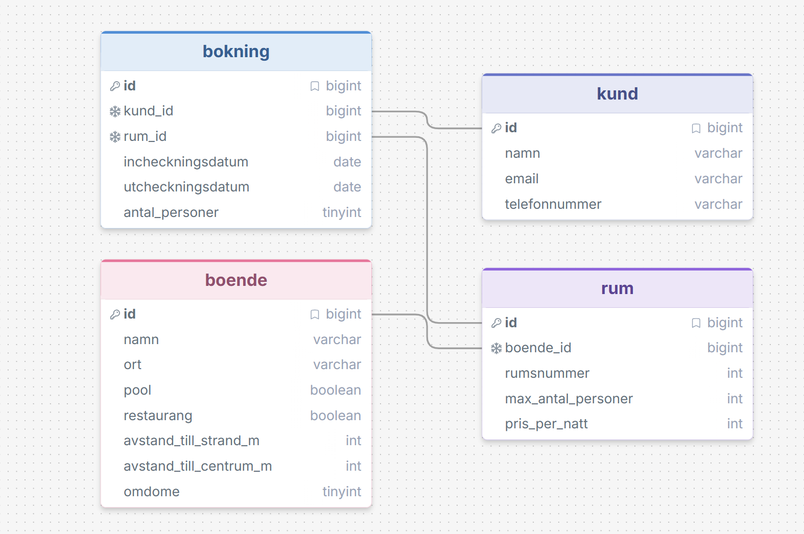

# Holiday Maker

## ER-diagram



## Datamodell

Databasen har fyra tabeller:

- boende: namn, ort, pool, restaurang, avstånd till strand och centrum (meter) och omdöme (1-5).
- rum: rumsnummer, max antal personer och pris per natt. Varje rum tillhör ett boende.
- kund: namn, e-post och telefonnummer.
- bokning: kopplar en kund till ett rum under en period, med incheckning, utcheckning och antal personer.

Relationerna är att ett boende har många rum, ett rum kan ha många bokningar och en kund kan ha många bokningar. De främmande nycklarna är rum.boende_id, bokning.rum_id och bokning.kund_id.

Databasen använder primärnycklar, främmande nycklar, NOT NULL, UNIQUE (kundens e-post, och rumsnummer inom ett boende) och CHECK-regler (omdöme mellan 1 och 5, avstånd minst 0, kapacitet och pris över 0, antal personer över 0 och utcheckning efter incheckning).

## Förutsättningar

- .NET 10 SDK
- MySQL 8.x

NuGet-paketet MySqlConnector hämtas automatiskt av dotnet.

## Skapa databasen

Kör skriptet skapa_databas.sql i en databasklient, till exempel MySQL Workbench, eller från kommandoraden:

```
mysql -u root -p --default-character-set=utf8mb4 < skapa_databas.sql
```

Skriptet skapar databasen public med tabeller och testdata: 5 boenden, 20 rum, 9 kunder och 26 bokningar. Om tabellerna redan finns i public tas de bort och skapas om, så kör det inte om du har data där som du vill behålla.

## Köra programmet

Anslutningssträngen ligger överst i HolidayMakerApp/Program.cs:

```
Server = localhost; Port = 3306; Database = public; User ID = root; Password = kurslosenord
```

Ändra den om din databas har en annan adress, port eller ett annat lösenord. Starta programmet:

```
cd HolidayMakerApp
dotnet run
```

## Använda programmet

Huvudmenyn har tre val: välj en befintlig kund, registrera en ny kund och avsluta.

När en kund är vald finns dessa val:

1. Sök lediga rum och boka. Ange ort, incheckning, utcheckning (åååå-mm-dd) och antal personer. Därefter kan du välja filter: pool, restaurang, maximalt avstånd till strand och maximalt avstånd till centrum. Resultatet sorteras efter lägst pris eller högst omdöme. När du väljer ett rum sparas bokningen och du får en bekräftelse med bokningsnummer och totalpris.
2. Visa kundens bokningar.
3. Ändra antal personer i en bokning. Det nya antalet måste rymmas i rummet.
4. Avboka. Bokningen tas bort efter en bekräftelse och rummet blir ledigt igen.
5. Tillbaka.

## Tillgänglighet

Ett rum är ledigt för en period om ingen annan bokning överlappar den:

```sql
NOT EXISTS (
    SELECT 1 FROM bokning
    WHERE bokning.rum_id = rum.id
      AND bokning.incheckningsdatum < @ut_check
      AND bokning.utcheckningsdatum > @in_check
)
```

Villkoret fångar alla typer av överlapp, även när den ena perioden helt omsluter den andra. Jämförelsen är strikt (< och >), så utcheckningsdagen upptar inte rummet och en kund kan checka in samma dag som en annan checkar ut. Tillgängligheten kontrolleras vid sökningen och igen precis innan bokningen sparas.

Alla SQL-frågor skickas med parametrar (till exempel @namn och @rum_id) och aldrig genom att sätta ihop text, vilket skyddar mot SQL-injektion. Sökning, filtrering och sortering sker i SQL.

## Projektstruktur

- HolidayMakerApp/Program.cs: anslutning och huvudmeny
- HolidayMakerApp/CustomerHandler.cs: välja och registrera kund, kundmenyn
- HolidayMakerApp/RoomBooking.cs: sök lediga rum och boka
- HolidayMakerApp/BookingHandler.cs: visa bokningar, ändra antal personer, avboka
- HolidayMakerApp/ConsoleInput.cs: hjälpmetoder för inmatning
- HolidayMakerApp/RoomSearch.cs: samlar sökvillkoren
- skapa_databas.sql: skapar databasen och lägger in testdata
- Övriga .sql-filer: frågor som provades i en databasklient innan de användes i C#

## Manuella tester

Testen använder den medföljande testdatan. Välj kunden Johan Berg och avboka testbokningarna efteråt.

- Ledigt rum visas och upptaget döljs: sök Trelleborg 2026-12-10 till 2026-12-12 för 2 personer och boka rum 810. Sök igen, då ska rum 810 saknas.
- Boka samma dag som någon checkar ut: sök Trelleborg 2026-12-12 till 2026-12-13. Rum 810 ska visas.
- Överlappande bokningar nekas, även när en period omsluter en annan: sök Trelleborg 2026-12-09 till 2026-12-13. Rum 810 ska inte visas.
- För stort sällskap: sök Trelleborg 2026-12-10 till 2026-12-12 för 5 personer. Rum med plats för färre än 5 ska inte visas.
- Kombinerade filter och båda sorteringarna: sök Trelleborg 2026-12-27 till 2026-12-28 för 1 person, först med sortering efter pris och sedan efter omdöme. Priset ska stiga i den första listan och omdöme 5 ska komma före 4 i den andra. Prova också pool, restaurang och avstånd tillsammans.
- Ändra antal personer följer kapaciteten: ändra bokningen i rum 810 (max 4 personer) till 5, vilket ska nekas, och sedan till 3, vilket ska sparas.
- Avbokning frigör rummet: avboka bokningen och sök igen. Rum 810 ska vara ledigt.
- Uppgifterna finns kvar efter omstart: stäng programmet, starta det igen och visa kundens bokningar.